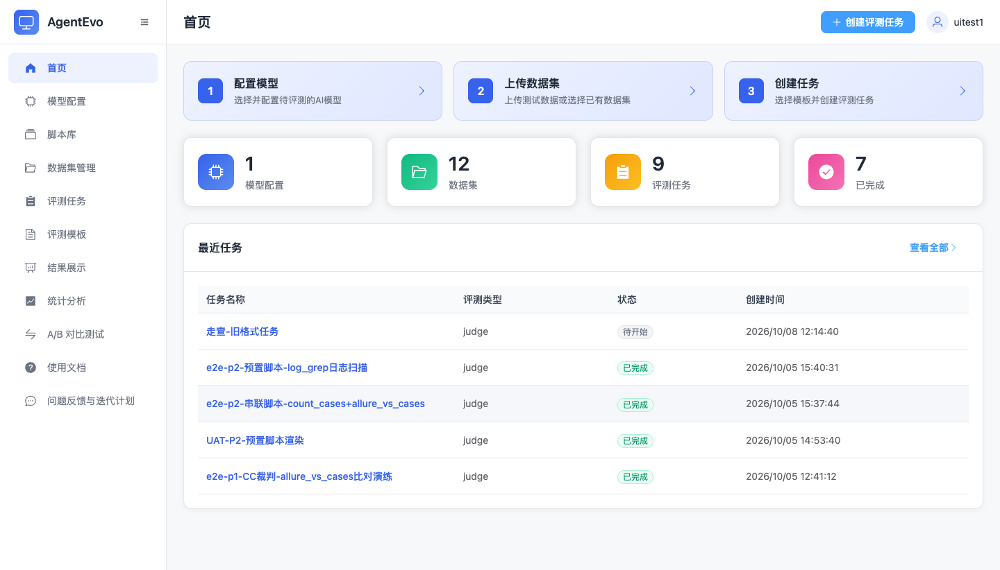

# AgentEvo — Self-hosted AI Evaluation Platform

Systematically and quantitatively evaluate the response quality of LLMs and Agents — model configs, dataset management, pre-evaluation scripts, 9 evaluation types with AI judges, result analytics and A/B testing. Built with FastAPI + Vue 3 + Celery, deployable as a single Docker Compose stack.



[](https://github.com/mahingbun-dev/ai-evo/actions/workflows/ci.yml)


[中文文档](README.zh-CN.md)

## What it does

Preparation → Evaluation → Analysis, in one platform:

| Module | Capabilities |
|---|---|
| Model configs | OpenAI / Anthropic compatible endpoints, custom HTTP (import from curl), runtime variable injection, streaming connectivity test |
| Datasets | Excel import (dynamic fields), Agent session file import, media fields, field-level validation |
| Script library | Pre-evaluation scripts (zip / folder packages), `model.py` contract declaration, online file-tree editing, scaffold templates |
| Evaluation tasks | AI judge / Agent long-session / consistency / success-rate / RAG retrieval / binary classification, batch runs, real-time progress over WebSocket |
| Judge engines | Claude Code judge, DeepSeek Harness judge, generic LLM judge graph; per-task evaluation dimensions |
| Results & analytics | Score details, run-to-run history, Excel/JSON/CSV export, trend statistics, side-by-side A/B comparison |
| Administration | Teams and user enable/disable (super admin), audit log, built-in user guide |

First registered user automatically becomes the super admin; sessions are JWT (`Authorization: Bearer`), passwords stored as PBKDF2-HMAC-SHA256 hashes.

## Quick start (local development)

Prerequisites: Python 3.12+, Node.js 18+ with pnpm, Docker (for PostgreSQL and Redis).

```bash
# 1. Start PostgreSQL + Redis (dev containers)
docker compose -f docker-compose.dev.yml up -d

# 2. Backend dependencies (use a virtualenv)
python -m venv .venv && source .venv/bin/activate
pip install -r requirements.txt

# 3. Configure environment (.env is not committed)
cp .env.example .env
#   set DATABASE_URL / REDIS_URL / AUTH_JWT_SECRET

# 4. Run database migrations
export AIEVO_DATABASE_URL="$DATABASE_URL"
alembic upgrade head

# 5. Start the backend (port 8100)
python scripts/run_local_dev.py

# 6. Start the frontend (another terminal, /api proxies to 8100)
cd frontend && pnpm install && pnpm dev   # https://localhost:3000
```

Open `https://localhost:3000` → register (first user becomes super admin) → add a target model and a judge model under **Model Configs** → import a dataset from Excel → create and run an evaluation task.

## Deploy with Docker Compose

The image is built online (`Dockerfile.online`: Node stage builds the frontend, Python stage installs dependencies):

```bash
cp .env.example .env   # set DATABASE_URL / REDIS_URL / AUTH_JWT_SECRET / IMAGE_TAG
docker compose up -d --build
```

- `api` serves both the REST API and the built frontend on port 8100 (`AIEVO_PORT` to change)
- `worker` runs Celery evaluation tasks; `logs/` and `uploads/` are persisted via volumes
- on the first `up -d`, the one-shot `volume-init` service automatically migrates the
  `uploads/` and `logs/` volume ownership to the container runtime user (uid 10002) —
  no manual `chown` needed (`docker compose ps` showing it as `exited(0)` is normal)
- set `COMPOSE_PROFILES=bundled-db` in `.env` to also start a bundled PostgreSQL
- pre-evaluation script execution mode `SCRIPT_EXEC_MODE`: the default `local` is
  **for development machines only** (scripts run as plain subprocesses next to the
  platform); production/enterprise deployments must not use `local` — set
  `SCRIPT_EXEC_MODE=container` once the sandbox channel is in place, see
  section 9 of [docs/build-pipeline.md](docs/build-pipeline.md)

The full `.env` variable reference is in section 4.4.1 of
[docs/build-pipeline.md](docs/build-pipeline.md) and `.env.example`;
the offline/CI pipeline (locked wheels, bundled Claude Code CLI) is described in [docs/build-pipeline.md](docs/build-pipeline.md).

## Evaluation types

| Type | One-liner | Needs a judge model |
|---|---|---|
| AI judge | LLM judge scores model outputs on configured dimensions | Yes |
| Agent (long session) | Judge scores imported agent session transcripts | Yes |
| Consistency | Same input called N times, measures output stability | Optional |
| Success rate | Share of successful calls | No |
| RAG retrieval | Precision / recall and 4 more retrieval metrics | Partial |
| Binary classification | Label comparison: accuracy / sensitivity / specificity | No |

## Documentation

- [User guide (中文, with screenshots)](docs/user_guide.md)
- [Quick start (中文)](QUICK_START.md)
- API docs are served by the backend at `/api-docs` once running

## Security notes

- `AUTH_JWT_SECRET` must be set to a strong random value (`openssl rand -hex 32`):
  startup fails fast when it is missing; the "derive from DATABASE_URL" fallback
  requires explicitly setting `AUTH_JWT_ALLOW_DERIVED=true`, is for local development
  only, and must never be enabled in enterprise deployments
- `SCRIPT_EXEC_MODE=local` (pre-evaluation scripts run as plain subprocesses) is for
  development machines only and forbidden in enterprise deployments; the compliant
  path is `container` sandbox mode — see section 9 of [docs/build-pipeline.md](docs/build-pipeline.md)
- anc-hub endpoints use strict TLS verification by default; self-signed internal endpoints can opt out with `AIEVO_HUB_TLS_INSECURE=1`
- This platform intentionally calls user-configured model endpoints (including internal gateways) — deploy it inside a trust boundary you control

## License

[Apache-2.0](LICENSE)
